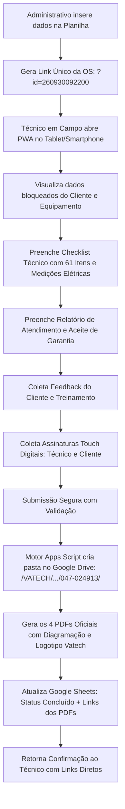

# SISTEMA DE GESTÃO DE ATENDIMENTO E DOCUMENTAÇÃO TÉCNICA EM CAMPO
### Vatech Brasil & Exacta Manutenções — Solução Google Apps Script Web App (PWA)

---

## 1. Visão Geral da Arquitetura

Esta solução foi concebida por Engenharia de Software Full-Stack especializada no ecossistema Google (Google Apps Script, Web Apps, Google Drive API e Google Sheets). Ela automatiza integralmente o fluxo de homologação técnica de visitas de instalação e manutenção para equipamentos odontológicos Vatech (como a linha PaX-i e tomógrafos odontológicos 3D).

### Fluxo Operacional:


---

## 2. Estrutura dos Arquivos do Projeto

Os arquivos desenvolvidos encontram-se estruturados na pasta `src/`:

```
c:\Users\Micro\Documents\Exacta\Vatec\Limeira - instalação\
├── src/
│   ├── Code.gs             # Controlador central (doGet, doPost, Drive API, Sheets)
│   ├── PdfTemplates.gs     # Motor de renderização HTML dos 4 documentos oficiais Vatech
│   ├── Index.html          # Shell da aplicação web PWA mobile-first responsiva
│   ├── Styles.html         # Estilos ergonômicos touch com botões táteis ampliados
│   ├── Scripts.html        # Lógica client-side, Canvas de assinatura de alta resolução e auto-save
│   └── appsscript.json     # Manifesto de configuração e escopos OAuth do Google Apps Script
├── local-preview.html      # Simulador autônomo para testes locais em qualquer navegador
└── README.md               # Este guia completo de implantação e operação
```

---

## 3. Mapeamento Rigoroso dos 4 Documentos Oficiais

Com base na análise minuciosa dos PDFs originais de referência da instalação de Limeira (`PaX-i 047-024913`), os modelos replicam 100% da identidade visual, proporções, tabelas, bordas, notas legais e cabeçalhos:

| Documento | Nome do Arquivo Gerado no Drive | Conteúdo Principal |
| :--- | :--- | :--- |
| **Checklist Pós-Instalação** | `Checklist_Pos_Instalacao_[N_Serie].pdf` | Cabeçalho técnico, dados do cliente/equipamento, **61 itens distribuídos pelas 8 categorias oficiais**, tabela de medições de tensão do Nobreak (FF, FN, F1T, F2T, NT), especificações de CPU/Monitor, softwares ativados (Floating/30dias), versões de software e assinaturas do técnico e cliente. |
| **Relatório de Visita Técnica** | `Relatorio_Visita_Tecnica_[N_Serie].pdf` | Dados cadastrais completos da Vatech Brasil (CNPJ, IE, endereço), dados gerais da intervenção, horários de início e fim, período, garantia, caixa de descrição técnica de intervenção detalhada e termo de funcionamento. |
| **Certificado de Garantia** | `Termo_Garantia_[N_Serie].pdf` | Número da OS, dados do cliente, nota fiscal, prazos de garantia total (5 anos), **todos os 16 artigos e cláusulas legais oficiais da Vatech na íntegra** e aceite assinado pelo cliente. |
| **Feedback do Cliente** | `Feedback_Cliente_[N_Serie].pdf` | Avaliação do treino (Ótimo a Péssimo), checklist dos 8 itens de posicionamento orientados, checklist de ferramentas do software EzDent-i e Ez3D-i, campos dissertativos sobre treinamento e processo de entrega, além do quadro oficial de suporte científico Vatech 3D. |

---

## 4. Passo a Passo de Implantação no Google Workspace

### Passo 1: Criar a Folha de Cálculo Central (Google Sheets)
1. Acesse o seu Google Drive e crie uma nova folha de cálculo com o nome:
   `Vatech & Exacta - Controle de Atendimentos em Campo`
2. No menu superior da planilha, aceda a **Extensões** > **Apps Script**.

### Passo 2: Copiar os Arquivos do Projeto para o Apps Script
No painel lateral esquerdo do Google Apps Script:
1. No arquivo `Código.gs` (renomeie para `Code.gs` ou mantenha), cole o conteúdo de `src/Code.gs`.
2. Clique no botão **+** > **Script** e crie o arquivo `PdfTemplates.gs`, colando o conteúdo de `src/PdfTemplates.gs`.
3. Clique no botão **+** > **HTML** e crie os 3 arquivos HTML:
   - `Index.html` (cole o conteúdo de `src/Index.html`)
   - `Styles.html` (cole o conteúdo de `src/Styles.html`)
   - `Scripts.html` (cole o conteúdo de `src/Scripts.html`)
4. Em **Configurações do Projeto** (ícone de engrenagem à esquerda), marque a opção **Mostrar arquivo de manifesto "appsscript.json" no editor** e cole o conteúdo de `src/appsscript.json`.

### Passo 3: Inicializar a Base de Dados
1. No editor do Apps Script, selecione a função `setupDatabase` no seletor de funções superior e clique em **Executar**.
2. Conceda as autorizações de segurança solicitadas na primeira execução.
3. A folha de cálculo será configurada automaticamente com a aba `Atendimentos`, contendo as 11 colunas formatadas nas cores institucionais Vatech e o registro padrão de teste de Limeira (`PaX-i 047-024913`).

### Passo 4: Publicar a Aplicação Web (Deploy Web App)
1. No canto superior direito do Apps Script, clique no botão azul **Implantar** > **Nova implantação**.
2. Clique no ícone de engrenagem ao lado de "Selecione o tipo" e escolha **App da Web**.
3. Configure os seguintes parâmetros:
   - **Descrição:** `Vatech Field Service PWA v1.0`
   - **Executar como:** `Eu (seu-email@dominio.com)` *(Garante permissão para gravar na pasta do Drive e atualizar o Sheets)*
   - **Quem pode acessar:** `Qualquer pessoa` *(Permite que o técnico acesse pelo smartphone/tablet no link direto sem exigência de conta corporativa)*
4. Clique em **Implantar** e copie a **URL do App da Web** gerada (exemplo: `https://script.google.com/macros/s/.../exec`).

---

## 5. Operação em Campo

### 1. Envio da OS para o Técnico
Basta anexar o parâmetro `?id=[ID_Atendimento]` ao final do link da Web App.
*Exemplo:* `https://script.google.com/macros/s/.../exec?id=260930092200`

### 2. Execução pelo Técnico
1. O técnico abre o link no smartphone ou tablet (pode clicar em "Adicionar à tela de início" para usar como PWA em tela cheia).
2. Na aba **1. OS & Dados**, os dados do cliente e equipamento são apresentados protegidos contra alteração inadvertida.
3. Na aba **2. Checklist**, o técnico seleciona de forma ágil com botões táteis os 61 itens, informa o valor do disjuntor e digita as tensões elétricas da rede e do Nobreak.
4. Na aba **3. Relatório Visita**, confirma os horários de início e término e a descrição técnica.
5. Na aba **4. Garantia**, apresenta o termo de garantia ao cliente.
6. Na aba **5. Feedback Cliente**, passa o aparelho ao cliente para avaliação rápida do treinamento e processo de entrega.
7. Na aba **6. Assinaturas**, ambos assinam diretamente na tela (touch). O sistema possui auto-save em `localStorage` para evitar perda de dados caso a conexão oscile dentro de salas blindadas de raio-X.
8. Ao clicar em **Homologar e Transmitir Atendimento**, o sistema:
   - Gera os 4 PDFs com alta fidelidade de diagramação;
   - Cria no Google Drive a pasta `VATECH_DOCUMENTOS_TECNICOS / 047-024913 /`;
   - Salva os 4 arquivos em PDF com permissão de visualização;
   - Atualiza a planilha central para o status `Concluído` com os links diretos;
   - Exibe a tela de confirmação com acesso imediato a cada documento.

---

## 6. Como Testar Imediatamente no Computador

Para validar a experiência de uso, layout e renderização dos documentos sem precisar configurar o Google Apps Script previamente:

1. Dê um duplo clique no arquivo [`local-preview.html`](file:///c:/Users/Micro/Documents/Exacta/Vatec/Limeira%20-%20instala%C3%A7%C3%A3o/local-preview.html) para abri-lo no seu navegador (Google Chrome, Edge, etc.).
2. Teste a navegação entre as 6 abas, marque os itens do checklist e teste o componente de assinatura com o mouse ou tela tátil.
3. Clique em **👁️ Visualizar Prévia HTML dos 4 Documentos Oficiais** para inspecionar cada um dos 4 documentos técnicos renderizados fielmente.
